# Guide to the selected figures

Eleven current figures comprise seven original views and four academic presentation panels. All ten historical images remain at their original prototype paths; the four updated panels have 300-dpi PNG and vector PDF companions. Their captions, denominators and transferred original qualifications are in [proposal_figure_notes.md](proposal_figure_notes.md). The [presentation overlay](figure_presentation_updates.json) records the update while preserving the initial source registry. The [machine-readable registry](figure_registry.csv) records each source path, classification/visualization version, plotting function and statistic file.

Governance rates condition on eligible classified observations. Composition figures condition on Positive observations or on Practice assignments. These denominators answer different descriptive questions.

## 1. Annual Governance Positive rate

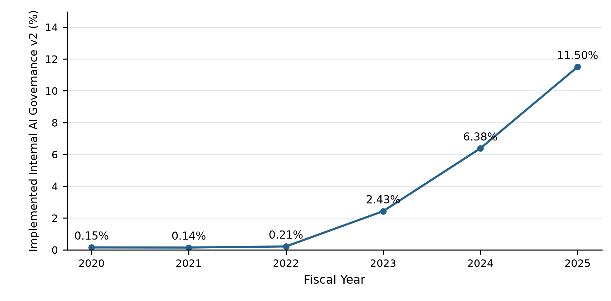

Scope: FY2020-FY2025. 8500 eligible firm-years; observed-section OR; single-section observations retained.

Numerator: Governance Positive firm-years. Denominator: All eligible classified firm-years in the fiscal year.

Data: `outputs/summary_statistics/governance/annual_trend_summary.csv`. Classification: `implemented-internal-ai-governance-v2.0`; visualization: `proposal_academic_v1_20261030`.

## 2. Firm-size composition within Governance Positive

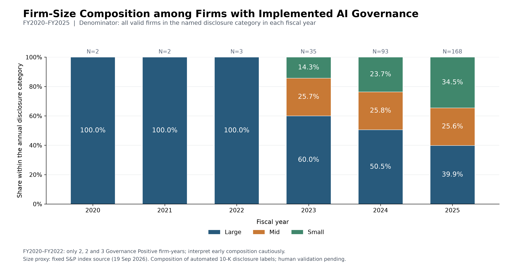

Scope: FY2020-FY2025. 303 Positive firm-years; fixed S&P index size proxy.

Numerator: Positive firm-years in the size group and fiscal year. Denominator: All Governance Positive firm-years in that fiscal year.

Data: `outputs/summary_statistics/governance/size_composition.csv`. Classification: `implemented-internal-ai-governance-v2.0`; visualization: `firm_size_within_disclosure_composition_v1_20261026`.

## 3. GICS composition within Governance Positive

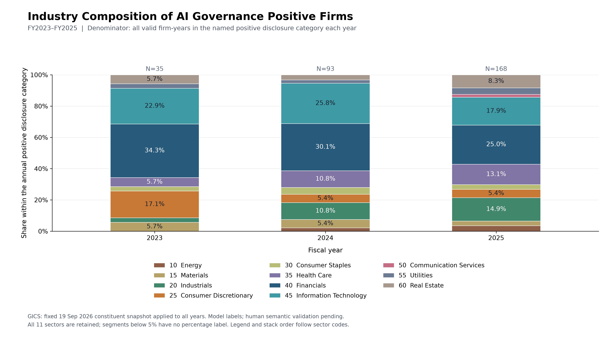

Scope: FY2023-FY2025. 296 Positive firm-years in FY2023-FY2025; all 11 GICS Sectors.

Numerator: Positive firm-years in the GICS sector and fiscal year. Denominator: All Governance Positive firm-years in that fiscal year (35, 93, 168).

Data: `outputs/summary_statistics/governance/annual_industry_composition.csv`. Classification: `implemented-internal-ai-governance-v2.0`; visualization: `industry_within_disclosure_composition_v1_20261028`.

## 4. Annual Size x Industry Governance Positive rate

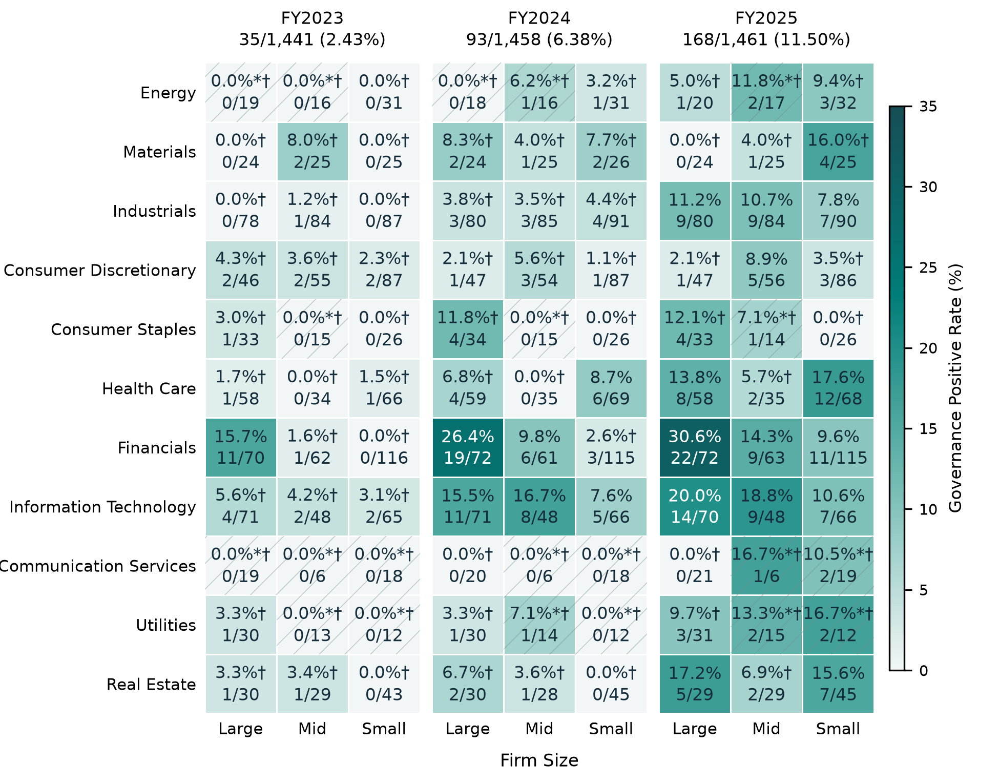

Scope: FY2023-FY2025. 4360 classified firm-years; 99 annual size-sector cells; 296 Positive.

Numerator: Governance Positive firm-years within Year x Size x GICS Sector. Denominator: Valid binary firm-years within the same cell.

Data: `outputs/summary_statistics/governance/size_industry/year_size_sector_statistics.csv`. Classification: `implemented-internal-ai-governance-v2.0`; visualization: `proposal_academic_v1_20261030`.

## 5. Change in Size x Industry Governance Positive rates

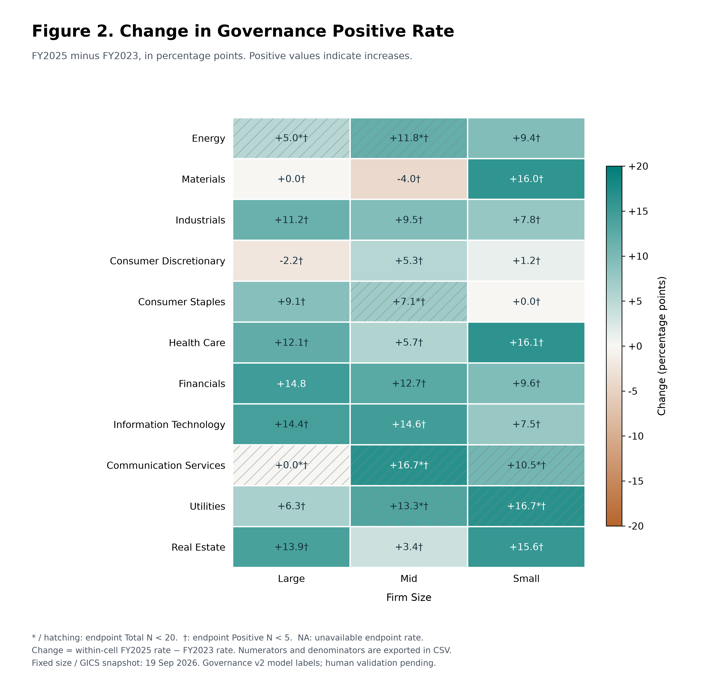

Scope: FY2023 to FY2025. 33 size-sector cells; source small-N and sparse-Positive flags retained.

Numerator: Difference between the two existing cell rates. Denominator: Each endpoint has its own valid classified cell denominator.

Data: `outputs/summary_statistics/governance/size_industry/rate_changes.csv`. Classification: `implemented-internal-ai-governance-v2.0`; visualization: `governance_size_industry_v1_20261028`.

## 6. Pooled Size x Industry Governance Positive rate

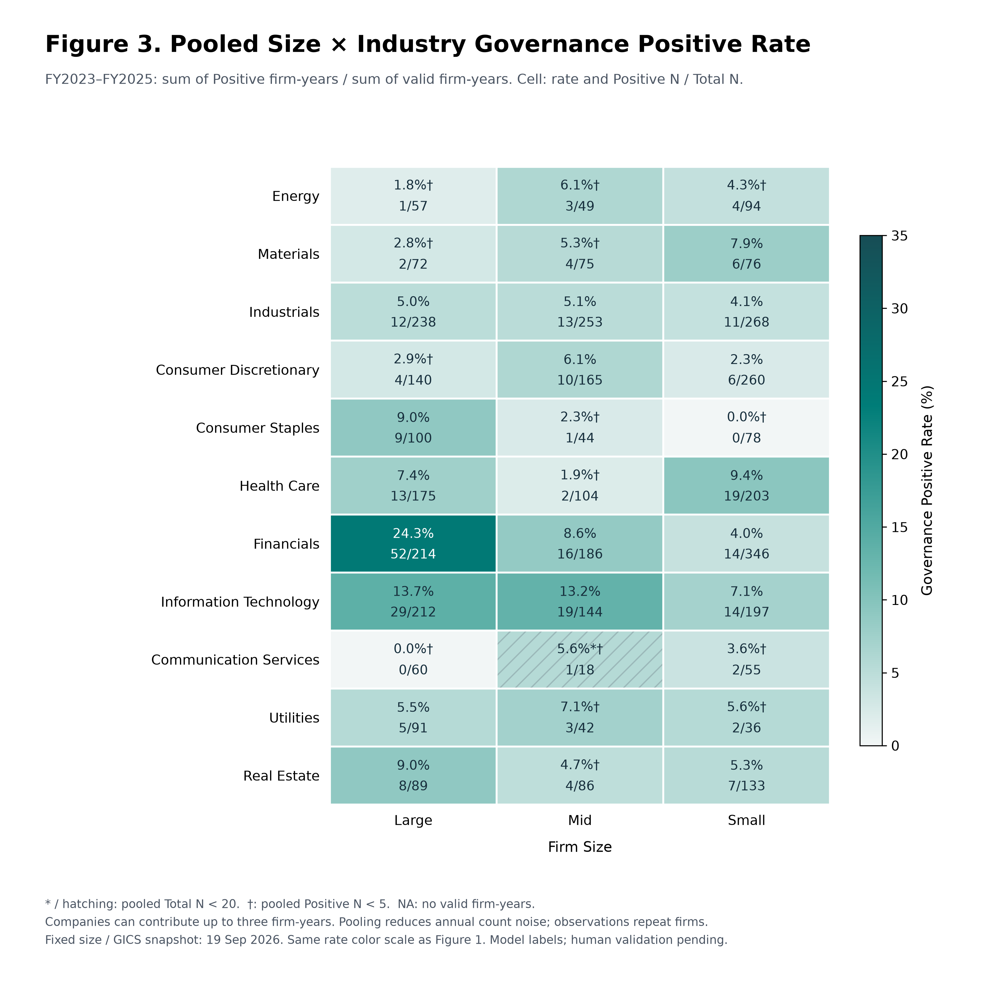

Scope: FY2023-FY2025 pooled. 4360 firm-year observations; 33 pooled cells; repeated firms across years count as firm-years.

Numerator: Sum of Positive firm-years in the size-sector cell over the three years. Denominator: Sum of valid classified firm-years in that cell over the three years.

Data: `outputs/summary_statistics/governance/size_industry/pooled_statistics.csv`. Classification: `implemented-internal-ai-governance-v2.0`; visualization: `governance_size_industry_v1_20261028`.

## 7. Distribution of disclosed governance practices

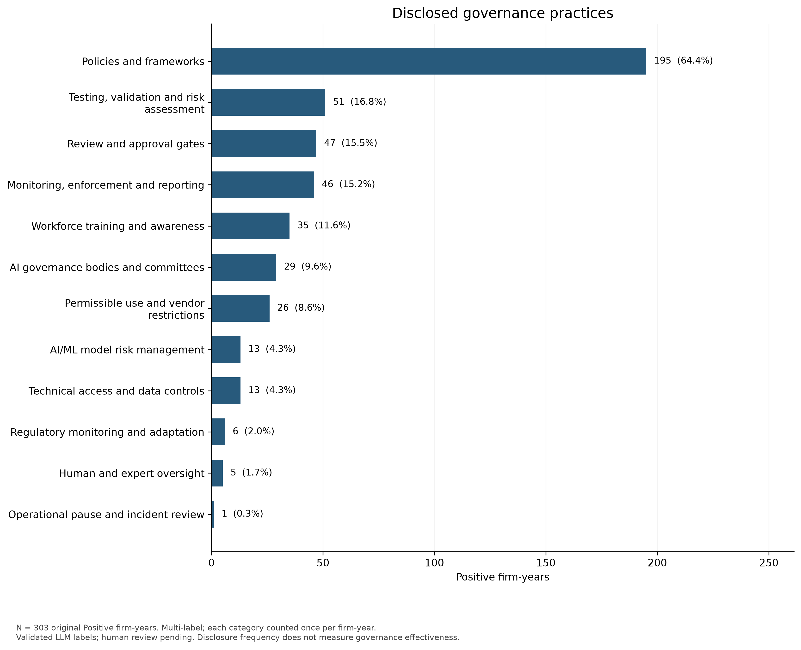

Scope: FY2020-FY2025. All 12 practices; 467 assignments; multi-label; zero-assignment and review cases retained in denominator.

Numerator: Positive firm-years assigned a Practice ID; deduplicated across evidence and sections. Denominator: All 303 Governance Positive firm-years.

Data: `outputs/summary_statistics/practices/practice_category_statistics.csv [scope=all]`. Classification: `implemented-ai-governance-content-v1.0`; visualization: `implemented-ai-governance-content-v1-20261018`.

## 8. Practice prevalence within annual Governance Positive samples

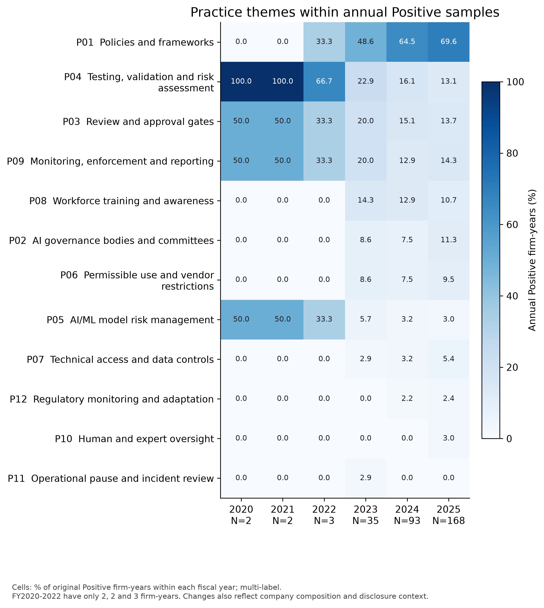

Scope: FY2020-FY2025. 72 year-practice cells; multi-label; early years have only 2-3 Positive observations.

Numerator: Distinct annual Positive firm-years assigned the Practice ID. Denominator: All Governance Positive firm-years in that fiscal year (2, 2, 3, 35, 93, 168).

Data: `outputs/summary_statistics/practices/practice_category_statistics.csv [scope=fiscal_year]`. Classification: `implemented-ai-governance-content-v1.0`; visualization: `implemented-ai-governance-content-v1-20261018`.

## 9. Annual composition of Practice assignments

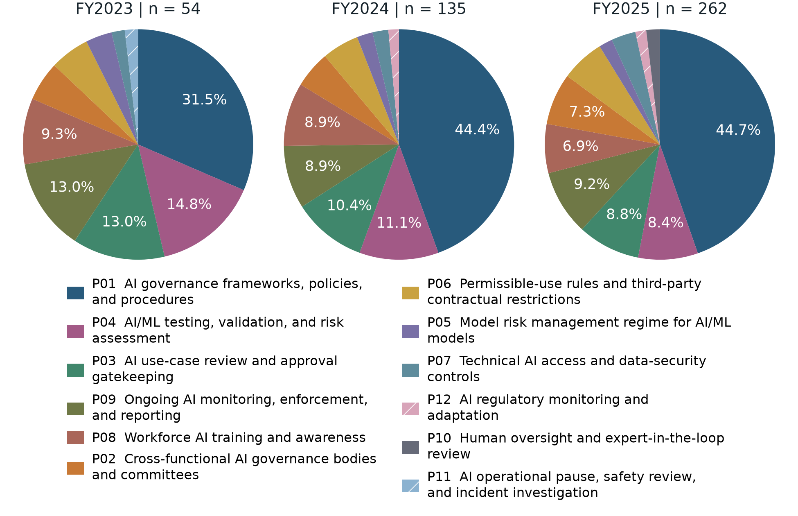

Scope: FY2023-FY2025. 296 Governance-Positive firm-years; 274 with a Practice; 451 assignments across the three displayed years; original full-period totals are 303 Positive firm-years and 467 assignments.

Numerator: Distinct annual firm-year assignments to the Practice ID. Denominator: Annual sum of distinct firm-year-Practice assignments over all 12 categories: 54, 135, 262.

Data: `outputs/summary_statistics/practices/annual_practice_composition.csv; annual_assignment_totals.csv`. Classification: `implemented-ai-governance-content-v1.0`; visualization: `proposal_academic_v1_20261030`.

## 10. Annual counts of Practice assignments

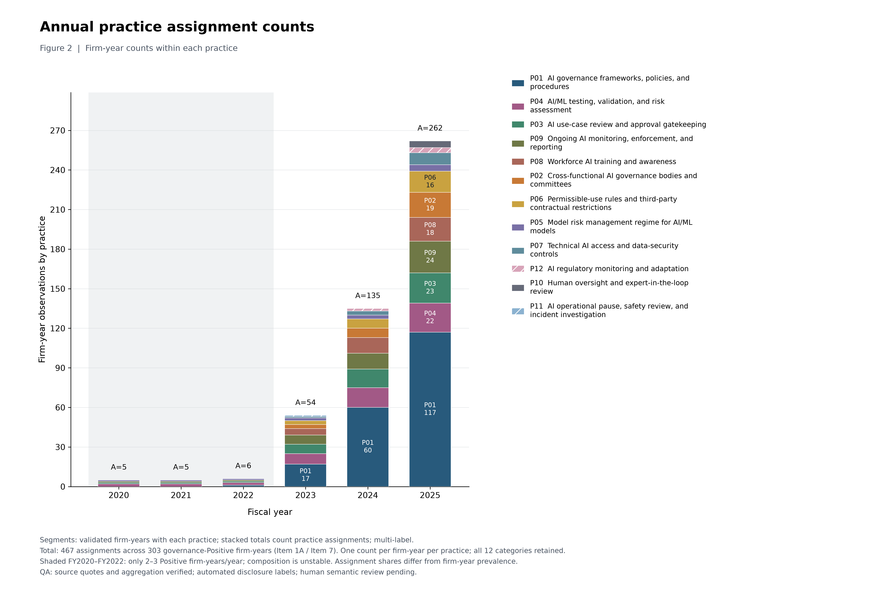

Scope: FY2020-FY2025; emphasis FY2023-FY2025. All 12 practices; annual assignment totals 5, 5, 6, 54, 135, 262.

Numerator: Distinct annual firm-year assignments to each Practice ID. Denominator: No percentage denominator; bar height is annual total assignments, not unique firm-years.

Data: `outputs/summary_statistics/practices/annual_practice_composition.csv; annual_assignment_totals.csv`. Classification: `implemented-ai-governance-content-v1.0`; visualization: `implemented-ai-governance-content-v1-20261018`.

## 11. Size-category governance rates with Financials and Information Technology excluded

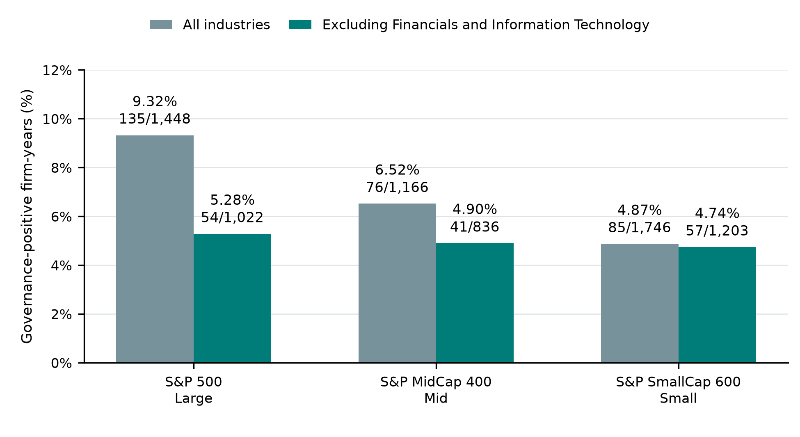

Scope: FY2023-FY2025 pooled. All sectors compared with the same population excluding Financials and Information Technology; fixed 2026-09-19 index/GICS snapshot; firms may contribute up to three observations.

Numerator: Sum of Governance-Positive firm-years within each size group and sector restriction. Denominator: Sum of valid classified firm-years within the same size group and sector restriction.

Data: `outputs/summary_statistics/governance/size_industry/pooled_statistics.csv`. Classification: `implemented-internal-ai-governance-v2.0`; visualization: `proposal_academic_v1_20261030`.

## Interpretation and selection

The binary annual trend and original Practice frequency/prevalence plots remain valid despite their earlier rendering date: later figures cite the same unchanged final datasets. The newer Practice composition plots use assignment shares, while the annual prevalence heatmap uses Positive firm-years. The three Size × Industry figures retain annual levels, endpoint changes and pooled levels as complementary views.

Size/GICS membership is the fixed 19 September 2026 retrieval snapshot. Early FY2020–FY2022 Positive counts are only 2, 2 and 3. All plots describe model-coded observed disclosure, with human semantic validation pending.

Portable replay uses copied drawing functions and bundled statistics. The initial ten-figure assembly evidence remains in `outputs/validation/figure_reproduction.json`; the current academic presentation replay is recorded separately in `outputs/validation/figure_reproduction_academic_20261030.json`.
